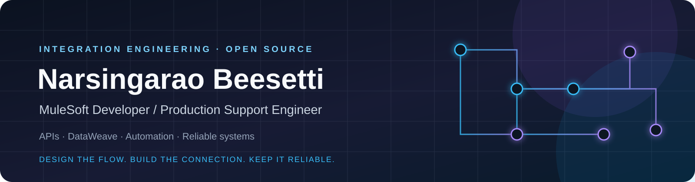

<!-- PROFILE INTRO -->

# Narsingarao Beesetti

### MuleSoft Developer & Production Support Engineer

**4.8+ years in IT** · **4+ years with MuleSoft** · API Engineering · Enterprise Integrations

  
  
  

*I build integrations, solve production problems, and turn practical ideas into useful software.*

---

## ◈ My engineering focus

I work across the full integration lifecycle: understanding business requirements, designing and developing Mule applications, connecting enterprise systems, and keeping integrations reliable in production.

| Build & integrate | Operate & improve |
|---|---|
| Mule 4 application development | L2/L3 production support |
| API-led connectivity, RAML and REST | Incident investigation and RCA |
| DataWeave 2.0 transformations | Runtime monitoring and health checks |
| Database, HTTP, SFTP and messaging | Deployment validation and release support |
| Reusable flows and error handling | Reliability, recovery and prevention |

## ◈ Technology map

  
  
  
  
  
  
  
  
  
  

## ◈ Selected builds

These projects reflect the areas I enjoy working on: integration engineering, developer productivity, backend systems, and learning tools.

<table>
  <tr>
    <td width="50%" valign="top">
      <h3>🧩 <a href="https://github.com/Narsing-s/muleforge">MuleForge</a></h3>
      A MuleSoft-focused builder concept for turning API requirements and source material into practical project assets.
       API design · Mule 4 · Developer tooling
    </td>
    <td width="50%" valign="top">
      <h3>🏦 <a href="https://github.com/Narsing-s/real-bank-api">Real Bank API</a></h3>
      Banking API experiments and backend integration workflows.
       REST APIs · Backend · Integration
    </td>
  </tr>
  <tr>
    <td width="50%" valign="top">
      <h3>📚 <a href="https://github.com/Narsing-s/sql-from-zero-to-advanced">SQL From Zero to Advanced</a></h3>
      A structured learning project for building SQL knowledge through progressive practice.
       SQL · Database fundamentals · Practice
    </td>
    <td width="50%" valign="top">
      <h3>🧠 <a href="https://github.com/Narsing-s/afterimage-context">Afterimage</a></h3>
      An exploration of context-aware productivity and memory-focused tools.
       Productivity · Context · AI experiments
    </td>
  </tr>
  <tr>
    <td width="50%" valign="top">
      <h3>🌐 <a href="https://github.com/Narsing-s/global-messanger">Global Messenger</a></h3>
      A communication platform project focused on connected experiences.
       Application development · Messaging
    </td>
    <td width="50%" valign="top">
      <h3>💳 <a href="https://github.com/Narsing-s/universal-banking-api">Universal Banking API</a></h3>
      Banking API work exploring reusable service and integration patterns.
       API design · Banking domain
    </td>
  </tr>
</table>

  <a href="https://github.com/Narsing-s?tab=repositories"><strong>Explore all repositories →</strong></a>

## ◈ My approach to engineering

- **Understand first** — trace the business flow before changing code.
- **Build for failure** — plan for timeouts, retries, duplicate events and partial failures.
- **Make it observable** — use meaningful logs, correlation IDs and actionable monitoring.
- **Protect production** — validate changes, communicate impact and verify recovery.
- **Share what I learn** — create practical examples and open-source tools that others can use.

## ◈ GitHub activity

  
  

  <picture>
    <source media="(prefers-color-scheme: dark)" srcset="https://raw.githubusercontent.com/Narsing-s/Narsing-s/output/github-contribution-grid-snake-dark.svg"/>
    <source media="(prefers-color-scheme: light)" srcset="https://raw.githubusercontent.com/Narsing-s/Narsing-s/output/github-contribution-grid-snake.svg"/>
    
  </picture>

## ◈ Let's connect

Open to meaningful conversations about MuleSoft, API integrations, backend engineering, production reliability, and open-source collaboration.

- GitHub: [@Narsing-s](https://github.com/Narsing-s)
- Repositories: [Explore my work](https://github.com/Narsing-s?tab=repositories)

---

  
    
  **Design the flow. Build the connection. Keep it reliable.**
   
  Thanks for visiting my corner of GitHub.
    
  

